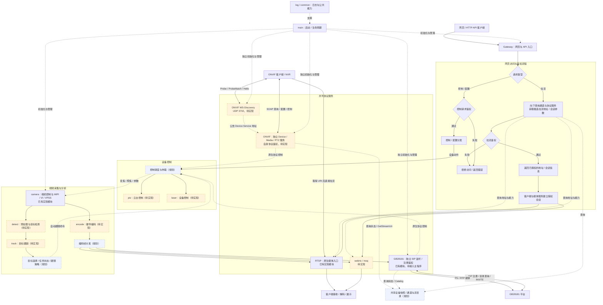
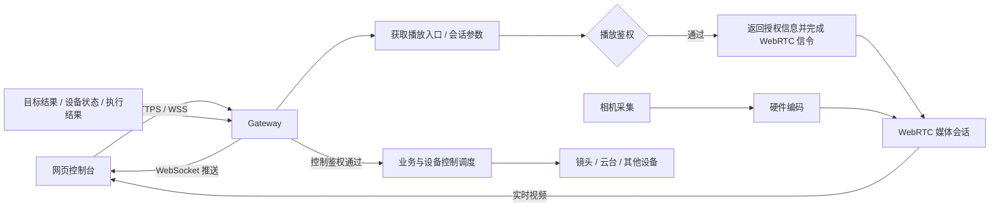

# UAV_detection 整体架构建议

状态：目标架构与迁移提案，已实现部分按下表标注。依据 2026-10-12 工作区中的实际源码，包含当前未提交的相机与 Gateway 实现。

2026-10-22 编码链路更新：已接 RGB 主通道 2566×1520、子通道 1920×1080、热成像 640×512，每源独立 RTSP/WebRTC/MoQ 编码，WebRTC 每源默认一个订阅且三源可并发；RTSP/MoQ 多订阅共享编码。板端 `--encode` 启动三源 RTSP，Gateway 同时启用时提供 WebRTC 信令及预览页。当前实现见 [媒体编码与订阅](media-encoding.md) 和 [WebRTC 实时视频](webrtc-live.md)；下方早期“encode/WebRTC 待实现”等状态不再代表当前进度，MoQ 网络协议栈仍待接入。

建议把项目定位为一个运行在昇腾板卡上的实时视觉设备：持续采集视频，执行目标检测与跟踪，按业务需要控制镜头和云台，同时向外提供视频、目标状态和设备状态。采用单进程模块化结构，按数据和资源的责任划分模块。

当前空目录均作为等待实现的模块纳入目标架构，包括 encode、detect、track、ptz、laser、onvif、webrtc、moq。Gateway 已实现 HTTP/HTTPS、WS/WSS、网页资源托管、登录会话与权限、配置持久化、命令及播放授权，具体能力与启动方式见 [Gateway 使用与接入](gateway.md)。网页控制台本身尚未开发，具体设备型号及算法策略仍需在实现相应模块时确定。

访问入口按客户端类型划分：网页及自定义 HTTP/WebSocket 客户端进入 Gateway；网页拉流请求先向下查询候选地址和会话参数，再鉴权，通过后返回入口。GB28181 和 ONVIF 各自提供独立的原生协议入口，其发现或注册、鉴权、查询、控制与媒体会话建立不经过 Gateway，也不依赖 Gateway Token。

ONVIF 在局域网直接响应 WS-Discovery，再通过自身 Device/Media/PTZ 服务提供功能；GB28181 设备直接向配置的平台发起 SIP 注册，平台查询 Catalog 并通过 INVITE 点播。国标平台接入不等同于 ONVIF 的组播扫描发现。各入口共享内部设备状态、控制仲裁和媒体源。

最终操作界面采用网页。网页的控制 API、状态订阅和视频会话建立均进入 Gateway；网页观看实时视频优先采用 WebRTC，RTSP 与国标继续服务对应客户端和平台。

雷达/频谱联动还需要增加外部观测适配、空间与时间对齐、目标关联及云台指向解算。设备可能异地安装，应同时补偿位置和朝向；具体流程见 [雷达、频谱与光电联动](sensor-linkage.md)。

**1. 当前实现意味着什么**

| 现有位置 | 实际职责与状态 | 对架构的影响 |
| --- | --- | --- |
| [main.cpp](../src/main.cpp) | 初始化可见光链路、抓帧、保存 YUV、输出统计，可选启动 Gateway | GB28181 尚未接入主程序生命周期，ONVIF 尚未实现 |
| [rgb_camera_ctl.h](../src/camera/rgb_camera_ctl.h) | 串口准备、MIPI/VI/VPSS 编排、同步借用帧，以及大量相机控制转发 | 适合作为过渡门面，长期应拆开采集资源与镜头控制的所有权 |
| [rgb_camera.h](../src/camera/rgb_camera.h)、[shihui_protocol.h](../src/camera/shihui_protocol.h)、[urt.h](../src/common/urt.h) | 工程参数、厂商协议、串口传输 | 已有分层可保留，把厂商语义限制在设备适配器内部 |
| [mipi_ctl.h](../src/camera/mipi_ctl.h) | MIPI、VI、VPSS，还包含 VENC 相关辅助函数 | 是底层媒体适配代码，不应成为算法和业务层的公共头文件 |
| [rtp_source.h](../src/rtsp/rtp_source.h) | H.264 打包为 RTP，并分发到 RTSP 客户端 | 应继续归 RTSP 适配器；协议中立的视频源应位于它上游 |
| [gb28181device.h](../src/gb28181/gb28181device.h) | SIP/XML、设备查询与控制回调、媒体会话入口 | 可保留门面，通过适配器接统一视频流和业务命令 |
| detect、track、encode、ptz 等目录 | 当前没有实现文件 | 这些是计划中的能力，不能据目录推断端到端功能已存在 |
| [gateway](../src/gateway/gateway.h) | HTTPS/WSS、网页托管、登录/刷新/退出、配置保存、状态推送、播放授权及异步命令 | 后端接入层已实现；真实媒体与雷达适配器按内部接口接入 |
| [CMakeLists.txt](../CMakeLists.txt) | 统一收集源码，链接到一个可执行目标 | 编译选项已有雏形，但模块依赖尚未由构建目标约束 |

核心缺口是：业务状态由谁管理，视频缓冲由谁持有，慢消费者如何隔离，设备控制如何仲裁，以及出错后重启到哪个边界。

**2. 整体流程：网页入口与原生协议入口并列**



图表示目标流程，尚未全部贯通。实线表示访问步骤或视频数据流；虚线表示内部查询、控制及支撑关系。网页遵循“解析候选入口 → Gateway 鉴权 → 返回入口”；GB28181 和 ONVIF 按各自协议直接接入。ONVIF 发现返回设备服务地址，GetStreamUri 返回媒体 URI，实际视频由对应媒体协议承载；发现可用不代表媒体已经就绪。

视频链路保证连续出图；分析链路生成目标结果；控制链路把目标与操作意图转换为设备动作。三者有明确的时间与数据关联，但不要求每帧同步完成全部步骤。

默认情况下，检测慢一帧不会让编码等一帧；云台串口等待应答不会阻塞 NPU；网络发送不会占住采集回调。原始视频直接编码与叠加目标框的视频，应被定义为不同输出能力，叠框策略需要明确。

**3. 模块边界与所有权**

| 模块 | 拥有的资源或状态 | 对外提供的能力 |
| --- | --- | --- |
| UavApplication | 服务对象、启动依赖、退出流程、重启协调 | boot / run / stop；把接口连接起来 |
| BoardMediaRuntime | 进程级媒体环境、板级资源分配、硬件资源编号与缓冲预算 | 为采集、预处理、推理和编码提供明确的资源上下文 |
| CameraCapture | 某物理输入的 MIPI/VI/VPSS 链路 | 分析帧获取、采集状态、编码输出的底层连接能力 |
| CameraControl | 某镜头的串口协议对象与命令执行 | 变焦、聚焦、曝光等能力，以及遥测快照 |
| AnalyticsPipeline | 预处理、模型实例、检测与图像跟踪的执行资源 | 发布 DetectionResult / TrackResult |
| TargetService | 当前目标集合、选中目标、业务模式、目标丢失与重捕获状态 | 选择目标、启动/停止跟踪、读取目标快照、发布业务事件 |
| TargetController | 标定参数、控制周期、控制器内部状态 | 将有效目标与设备遥测转换成期望角速度或位置 |
| DeviceCommandArbiter | 云台/镜头控制权、命令有效期、执行顺序 | 协调人工操作、自动跟踪、后续巡航；设备停止优先 |
| MediaService | 编码器、编码配置、流注册表、EncodedStreamHub | 输出协议中立的编码帧；统一处理关键帧和码率调整请求 |
| Gateway | 网页/API 请求、登录会话、配置存储、播放授权、HTTP(S)/WS(S) 连接 | 提供网页托管与控制/状态接口；媒体校验限定码流和协议的播放凭据；与原生协议服务并列 |
| 协议适配器 | 独立监听、发现/注册、协议鉴权及 RTSP、ONVIF、SIP/XML、PS/RTP 会话 | 直接接入客户端或平台；订阅视频、翻译控制命令、查询业务快照 |
| 基础设施 | 日志、配置加载、时间转换、诊断工具 | 支撑上述模块，不承载目标与跟踪业务 |

这些是责任边界，不要求首期为每行建立一个抽象基类。先用具体对象和少量接口组装；在硬件、模型、协议确实存在替换需求的位置引入接口。

UavApplication 是装配入口，不能逐渐接管目标选择、相机参数转换、RTP 打包等业务。BoardMediaRuntime 通过显式引用注入；进程级唯一资源不意味着要使用全局单例。SDK 要求的初始化、设备上下文及结束顺序，在平台适配层集中实现并按当前板卡验证。

CameraCapture 与 CameraControl 分开后，控制串口断线和视频无帧可以分别诊断、恢复。但改变相机输出格式会影响采集链路，必须由应用协调停流、改格式、重新建链，不能作为普通曝光命令直接并发执行。

**4. 数据契约要先确定**

| 数据类型 | 至少包含 | 边界约束 |
| --- | --- | --- |
| FrameKey | 逻辑源 ID、源代次 epoch、帧序号 | 链路重启后更新 epoch，防止旧结果作用于新链路 |
| RawFrame | FrameKey、PTS、时间域、采集单调时间、宽高、像素格式、plane/stride、缓冲句柄 | 帧元数据与缓冲所有权分开；业务代码不依赖 hi_video_frame_info |
| PreprocessTransform | 源尺寸、裁剪、缩放、letterbox、旋转/镜像、配置版本 | 检测框能准确映射回源图和控制坐标 |
| EncodedFrame | StreamId、流代次、源帧关联、codec、PTS/DTS、随机访问帧标记、参数集版本、不可变缓冲 | 单位是一个完整访问单元，不能把任意一个 NAL 当成一帧 |
| DetectionResult | FrameKey、时间、模型版本、预处理变换、类别、置信度、目标框 | 约定目标框的坐标空间，避免各模块自行猜测 |
| TrackResult | FrameKey、track ID、观测时间、位置/速度、置信度与有效状态 | 区分测量结果与预测结果，保留数据新鲜度 |
| DeviceCommand | 设备 ID、请求 ID、来源、控制权代次、deadline、动作与参数 | 领域单位统一；协议速度档位在适配器内部转换 |
| DeviceSnapshot | 连接状态、姿态、镜头状态、时间与有效性 | 查询接口快速读取快照，不临时阻塞查询串口 |

物理相机、逻辑图像源、编码档位、协议通道、网络会话要分开编号。例如同一个 RGB 输入可以产生主码流和子码流，也可以被多个 RTSP 客户端和国标会话同时订阅；客户端数量不会决定相机数量或编码器数量。

SDK 句柄和内存类型由平台适配器解释，SDK 头文件不进入领域数据头文件。不要把 RawFrame 简化成一个 data 指针：设备内存、物理地址、CPU 可访问内存和不同平面的 stride 有不同约束。

硬件 PTS 和系统单调时间分别保存；PTS 为 0 也可以是有效时间。RTP 时间戳转换和 RTCP 的墙上时间映射由协议/时钟适配器负责。不同物理源的 PTS 在验证同步关系前不能直接比较；编码器不能可靠回传源帧标识时，关联策略和允许误差必须显式记录。

**5. 视频如何在这块板卡上流动**

当前配置是 2688×1520、相机输出 50 fps；VPSS chn0 为主尺寸，chn1 为 1920×1080。目标模型的输入形状尚未确定，分析分支尺寸应随模型和精度需求配置。

优先验证以下拓扑：

```text
MIPI → VI → VPSS
              ├─ 主路 → VENC → 编码流分发 → RTSP / 国标
              └─ 分析路 → 有界借帧 → DVPP 预处理 → NPU → 检测/跟踪
```

这是待板端验证的目标路径。需要实测 VPSS 与 VENC 的绑定、分析分支并发取帧、缓冲深度、像素格式和资源占用。若硬件直连不可用，再实现显式送帧的编码路径，并用相同的上层契约隔离差异。

按当前 SDK 封装，VPSS 输出通道数为 2。主编码路与分析路已经使用两路资源；如要同时增加子码流、叠框输出或不同尺寸分析，必须重新核算共享、复用及预处理资源，不能默认再多开一路。摄像头采集帧率、编码输出帧率和检测频率分别配置；当前 venc 辅助参数把源与目标帧率合在一起，接入真实编码时需要重新表达。

2688×1520 的紧凑 YUV420 帧约 6.13 MB，50 fps 的单路有效像素数据约 306 MB/s，尚未包含 stride 和额外读写。这只是数据量估算，用来说明整帧复制和队列积压需要预算，不代表板端实测吞吐。

**6. 缓冲、并发与背压是架构的一部分**

当前 getFrameOn 调用用户回调后立即 release VPSS 帧。回调里把裸地址投递到异步推理队列，会让推理访问已经归还的缓冲。应在适配层提供 RAII FrameLease，明确借用与归还：

- 无异步消费者时，回调结束即可归还；异常路径也必须归还。
- 异步 DVPP/NPU 操作引用该缓冲时，必须等操作完成或安全取消后才能归还。
- 如果 SDK 不适合长期持有 VPSS 帧，先写入自有预分配输入池，确认转换/复制完成后归还采集帧。
- 有限的引用计数不等于有限的持有量：限制在途帧数，停机和重启前等待归还；需要指定释放线程时，通过所有者执行器归还。

VENC 编码缓冲也有借用期限。默认考虑将完整编码访问单元复制一次到有界共享缓冲池，及时归还 VENC 缓冲；各协议和会话共享不可变编码数据，不因某个客户端长期持有硬件输出缓冲。是否保留编码输出的零拷贝租约，依据实测收益决定。

| 边界 | 建议策略 | 满载时的行为 |
| --- | --- | --- |
| 分析输入 | 首期一个在途任务、一个最新待处理帧；之后按实测调整 | 替换尚未处理的旧帧，并归还缓冲 |
| 检测到跟踪 | 有序结果投递，加最新状态快照 | 拒绝旧 epoch、过期或乱序结果；状态变化事件单独保留 |
| 目标状态到控制 | 控制周期读取最新有效快照 | 过期结果不继续产生跟随动作，进入丢失/保持/停止策略 |
| 编码到每个网络会话 | 独立有界队列，同时限制字节数、帧数、排队时长 | 拥塞会话独立丢弃或断开，不拖累其他会话 |
| 镜头/云台命令 | 按物理设备串行执行，有 deadline；连续速度指令可合并 | 旧控制权命令失效；停止命令优先，防止旧运动命令随后执行 |
| 未来录像分支 | 独立写盘队列与存储预算 | 明确报错或降级，不能反向阻塞实时链路 |

视频丢帧要保持解码依赖：新订阅或拥塞恢复时，等待适合随机接入的帧并提供对应参数集；不能任意丢弃参考帧后继续发送依赖它的帧。已经开始发送的 TCP interleaved 报文必须保持字节流完整，严重拥塞时关闭会话。UDP 分片丢失后的重同步也应可观测。

当前 RTSP 每个 RTP 包会 post 到 io_context，TCP 写队列没有容量限制；只在队列末端加上限仍可能让 post 队列积压。限流应发生在最早的异步投递入口，并且保留帧边界信息以决定整帧丢弃和重同步。

当前国标 pushFrame 在调用线程逐会话同步发送，TCP connect/send 也可能等待。必须把连接、发送、关闭和统计访问收敛到媒体会话的串行执行上下文。只把 targets 复制出 map 锁，不能保证同一个 pusher 的 push/close/stats 并发安全。

线程按阻塞边界安排：一个应用协调上下文、必要的分析取帧/推理执行资源、编码取流资源、网络事件循环和各设备串行执行器。保持 eXosip 现有信令线程，通过短回调转交命令。起步可用单线程网络 io_context；增加网络线程时显式使用 strand 或等价串行约束。对象数量不直接决定线程数量。

**7. 目标跟踪和设备跟随分开设计**

Tracker 负责“这一帧里的目标是谁、在哪里、怎样运动”。TargetController 负责“为了使选中目标保持在视场内，设备应怎样运动”。检测模块不直接向串口发命令。

TargetService 管理类似以下业务状态：

```text
观察 → 选择目标 → 跟踪 → 短时丢失 → 重捕获
                       └──────────→ 结束跟踪
```

人工操作可以取得设备控制权；自动跟踪在失去控制权时不继续排队旧指令。若以后加入巡航，由同一仲裁入口处理。控制周期独立于检测频率，使用带观测时间和有效期的跟踪结果；需要图像的跟踪器仍从分析分支获取图像，不能假设只有检测框就能逐帧跟踪。

控制算法还依赖图像尺寸、裁剪/镜像、焦距或变焦位置、视场角/标定和云台遥测。应先把检测框映射回约定的源坐标，再转换为角度误差；变焦期间更新标定关系。不能把像素偏差乘一个固定常数直接当作长期可用的云台控制接口。

OSD 默认读取带时间戳的最新有效结果，不等待同帧检测完成；过旧的框应隐藏或明确标记为预测。需要严格对应源帧的叠框输出时，另建有界延迟的输出分支，并核算资源与延迟。视频内叠框和独立目标元数据可以并存。

**8. 协议是边缘适配器，编码流是共同入口**

MediaService 发布统一 EncodedFrame，RTSP 适配器再转成 H.264/RTP，国标适配器再做 PS/RTP。协议中立层不含 RTSP 路径、国标通道 ID、SSRC 或网络 socket。保留现有 RtpSource 作为 RTSP 内部打包器，避免让编码器继承它。

同一编码配置尽量只编码一次，网络会话分别订阅；协议封装和传输参数可以不同。国标会话的 SSRC、序列号与 PS 状态仍按会话要求管理。编码器控制统一接收关键帧请求并合并频繁请求；RTCP 反馈先进入策略层，由策略协调码率，避免一个慢客户端直接改变所有订阅者的共享码流。

现有 RTSP 实现以 H.264 为入口，国标媒体已有 H.264/H.265 配置。首期共享视频可先选择 H.264；增加 H.265 时需要补齐 RTSP 适配器的能力协商、SDP 和打包实现，不能只修改公共 codec 枚举。

Gateway、GB28181、ONVIF 是并列的接入适配器。网页通过 Gateway 查询播放入口并鉴权；国标平台直接与 SIP 服务通信，ONVIF 客户端直接使用发现和 SOAP 服务。各自执行协议鉴权，原生协议不向 Gateway 申请 HTTP Token、WebSocket 票据或播放许可。

| 入口 | 发现 / 接入流程 | 鉴权与媒体 |
| --- | --- | --- |
| 网页 / HTTP API | 访问 Gateway，查询状态或创建播放会话 | Gateway Bearer 鉴权；网页播放先解析候选入口再鉴权，媒体服务校验对应会话 |
| GB28181 平台 | 设备直接 SIP REGISTER，平台查询 Catalog，INVITE 建立点播会话 | SIP 注册摘要鉴权及协议会话校验；PS/RTP 直接到平台 |
| ONVIF 客户端 / NVR | 局域网 WS-Discovery → Device Service → 能力、Profiles 和 GetStreamUri 查询 | 发现不要求 Gateway Token；服务与媒体按各自支持的协议方式鉴权，媒体直接进入 RTSP 等服务 |

ONVIF 发现服务在配置的网卡加入发现组播组，响应 Probe/Resolve，并公告可达的 Device Service 地址；该地址不能指向要求 Gateway Bearer Token 的 `/api/v1`。发现报文和设备服务地址要求参见 [ONVIF Core Specification 第 7 章](https://www.onvif.org/specs/2312/ONVIF-Core-Spec-v2312.pdf)，UDP 3702 的发现流程见 [ONVIF 客户端测试规范](https://www.onvif.org/wp-content/uploads/2019/07/ONVIF_Core_Client_Test_Specification_19.06.pdf)。

国标和 ONVIF 的状态查询读取共享 DeviceSnapshot，控制翻译为领域命令，与网页控制一起进入 DeviceCommandArbiter，避免多个入口争用同一云台。它们通过内部接口访问业务，不能把原生协议请求转成对 Gateway 的 HTTP 回环调用。当前国标 ptz_handler 返回 bool 后立即决定 Result，应明确“命令已受理”和“设备已执行成功”的语义。异步执行需要适配器增加完成通知或请求关联机制，并按协议要求应答，不能在排队后谎报执行成功，也不能阻塞信令线程等待慢设备。

当前代码中的 Gb28181Device/SipSession 已自行监听 SIP、配置注册鉴权及管理会话，没有 Gateway 依赖，但尚未在 main 中启动，也没有真实编码帧接入。ONVIF 目录仍待实现，图中的发现与 SOAP 入口是实现要求，当前版本尚不能被 ONVIF 客户端发现。

ONVIF 的发现/配置/控制，以及 WebRTC、MoQ 的媒体输出，各有独立职责。为满足网页控制与实时预览，WebRTC 与 Gateway 的网页接口进入首个可操作闭环；RTSP、国标接入复用相同编码源，其他协议按实现阶段增加适配器。协议数量不改变业务层。

**网页控制与视频预览**

网页通过三类通道使用设备：

| 通道 | 建议用途 | 后端边界 |
| --- | --- | --- |
| HTTPS API | 登录、通道列表、配置、选择目标、启动/停止任务、创建播放会话 | Gateway 完成路由、会话与权限处理，业务服务执行操作 |
| WSS / WebSocket | 推送设备状态、检测/跟踪结果、命令完成通知，以及连续控制命令 | Gateway 维护连接，控制调度执行有时效的设备命令 |
| WebRTC | 网页实时视频预览 | Gateway 管理信令和授权关联，WebRTC 媒体适配器处理实际媒体连接 |

WebSocket 提供浏览器与服务器的双向通信；WebRTC 通过信令交换会话描述和连接候选，建立媒体连接。参见 [MDN WebSocket API](https://developer.mozilla.org/en-US/docs/Web/API/WebSockets_API) 与 [MDN WebRTC 信令说明](https://developer.mozilla.org/en-US/docs/Web/API/WebRTC_API/Signaling_and_video_calling)。



浏览器原生播放链路不以 RTSP URL 或国标 PS/RTP 为输入；应由 WebRTC 媒体适配器输出浏览器可接收的视频。网页取得的“拉流地址”在此具体表示信令入口和会话参数，随后完成协商才能播放，不能仅把现有 rtsp:// 地址赋给 video 标签。作为另一种播放方案，HLS 可用于对延迟要求较低的监看；本项目包含云台交互，优先验证 WebRTC。浏览器播放方式和 HLS 相对 WebRTC 的延迟差异可参考 [MediaMTX 官方浏览器接入文档](https://mediamtx.org/docs/read/web-browsers)。

硬件编码结果可经编码帧分发直接进入 WebRTC 适配器，不强制经过 RTSP 中转。首期优先验证兼容的 H.264 编码档位；WebRTC 仍需要实现或接入相应协议栈，包含协商、媒体封装和传输，现有 RTP 发送器不能直接充当完整 WebRTC 服务。跨网络部署时按实际连通性配置 ICE/STUN/TURN，参见 [MDN WebRTC 连接说明](https://developer.mozilla.org/en-US/docs/Web/API/WebRTC_API/Connectivity)。

网页负责展示、参数编辑、人工操作和任务下发。推理、跟踪状态、跟随控制周期和设备控制权保留在板端；人工按住方向时发送有有效期的速度命令，松开时停止，页面断线或后台节流后由后端命令超时规则收敛到停止状态。持续执行的自动跟踪任务遵循单独的任务生命周期，不依赖网页定时器。

目标框可由 WebSocket 元数据在网页画布叠加，带上源尺寸、观测时间和流代次，处理缩放及过期结果。如果要求框与视频帧严格对应，应另行验证视频帧时间映射或板端同帧叠框；仅同时收到视频和元数据不代表二者已经同步。

Gateway 已支持用 web-root 托管构建后的网页静态资源，网页与 API 共用 HTTP/HTTPS 入口，并提供 SPA 路由、WS/WSS 和精确来源的 CORS。前端与板端 C++ 后端独立开发和构建，无需为承载静态资源额外增加一套业务后端。当前实现范围为后端及托管，前端控制台与 WebRTC 协议栈在开始实现时再按约束选型。

**9. 生命周期、恢复与配置**

启动时先解析并校验配置，配置日志，然后创建板级资源上下文、设备控制、采集/编码/分析资源，接通队列与回调，最后开放对外就绪状态。资源先准备、生产再启动；每个准备步骤失败都可按已取得的资源逆序回滚。

各接入服务分别配置启用开关、监听网卡/地址、端口与认证信息，由应用独立装配和启停。未设置 Gateway Token、Gateway 端口占用或单独停止 Gateway，只影响网页/API 入口；已启用的 GB28181 注册、ONVIF 发现和原生协议会话应继续服务。发现/设备信息服务就绪与编码/媒体就绪分别上报。这里的独立是服务生命周期与依赖边界，仍可部署在同一进程；进程级故障需要进程监督恢复。

退出时先拒绝新业务操作，撤销自动控制并优先执行停止；停止上游生产，取消或等待在途推理，结束编码取流，关闭媒体会话并清理有界队列，等待全部硬件租约归还，再拆编码/VPSS/VI/MIPI，结束设备控制和板级运行环境，最后刷新日志。生产者、消费者和异步回调有退出屏障，不能只依赖对象析构的碰巧顺序。

| 故障 | 恢复范围 | 对其他能力的预期影响 |
| --- | --- | --- |
| 镜头控制串口断线 | CameraControl 重连 | 采集继续；相关控制能力标为不可用 |
| 单个客户端拥塞/断线 | 该媒体会话 | 其他客户端、编码、分析继续 |
| Gateway 绑定失败或服务停止 | Gateway 接入服务 | 网页/API 不可用；独立启用的国标/ONVIF 服务继续 |
| NPU 推理失败 | 分析资源按策略重建 | 视频继续，检测能力标为降级 |
| 某输入持续无帧 | 对应采集图及相关下游协调重建 | 更新 epoch，清除旧结果与旧控制命令；其他独立输入尽量继续 |
| 进程级媒体环境故障 | 应用或外部进程监督恢复 | 明确上报设备不可就绪，避免模块各自重复全局初始化 |

恢复策略区分正常超时、连续无帧和设备故障，采用重试次数与退避。串口连接成功、采集资源创建成功、拿到第一帧、编码出第一帧、算法完成首次推理是不同就绪条件。

配置至少分为：板级资源与接线、相机输入、模型及预处理、编码档位、控制与标定、协议映射及网络会话限制。物理编号只在板级配置出现，业务使用逻辑 ID。Gateway 支持保存未附着适配器的设备和流配置，重启恢复，实际硬件/媒体适配器仍由应用装配；后续硬件热更新区分日志级别等即时参数，以及分辨率、模型、输出格式等需要重建资源图的参数。

诊断数据覆盖：各阶段帧率、丢帧原因、队列字节数/时长、在途租约数、采集到结果/发送的延迟分位数、当前目标数据年龄、串口命令等待时间、会话错误及重启原因。用这些判断瓶颈，避免只看到“累计抓到多少帧”。

**10. 代码与构建结构**

下面是目标归属，按迁移阶段逐步形成，不要求现在一次搬完：

```text
src/
  main.cpp                   读取参数，创建并运行应用
  app/                       装配、启动、退出、恢复协调
  domain/                    目标、业务模式、设备命令与状态
  media/                     RawFrame/EncodedFrame、流描述、租约契约、分发
  analytics/                 检测与跟踪流程、预处理契约
  control/                   目标跟随、控制权仲裁、标定关系
  platform/
    ascend/                  媒体运行环境、MIPI/VI/VPSS、DVPP、VENC、ACL 实现
    devices/                 世辉相机、UART、未来云台/其他设备驱动
  access/
    rtsp/                    现有 RTSP 实现与流适配器
    gb28181/                 现有 SIP/XML/PS/RTP 实现与命令适配器
  infra/                     日志、配置、时钟支持
tests/                       单元与主机集成验证
tools/                       板端诊断、抓帧和联调程序
config/                      示例配置与板型资源描述
cmake/                       工具链和依赖发现
```

编译依赖方向：应用负责装配；算法、控制和协议依赖明确的领域/媒体契约；平台实现相应接口。领域契约不包含 Boost.Asio、CANN 或厂商协议头。平台不反向依赖 RTSP/国标，协议不直接拥有相机或编码硬件。

用 CMake library target 逐步表达这些边界，例如 uav_domain、uav_media、uav_analytics、uav_control、uav_ascend、uav_rtsp、uav_gb28181，再由可执行目标选择链接。可按阶段合并小目标；按目标声明 include 和依赖，替代公共 common.h 引入所有第三方头。

native 构建应选择回放/假设备适配器并链接主机架构依赖，板端构建选择 Ascend 和目标架构依赖。当前 native 预设只关闭 Ascend，仍可能选中仓库内 aarch64 库，需要逐类依赖验证。XML、SIP、OpenSSL 等只由使用它们的目标查找和链接。

现有 tools 自测可迁入 CTest 或从 CMake 注册，保留串口假设备、国标假平台和解码验证的价值。硬件采集探针单独成为 tools 可执行程序，让生产主程序与板端诊断各有清晰入口。整理版本管理时，源码、工具链与必要测试应可追踪，生成产物放 build；现有 .gitignore 忽略 cmake/ 和 tools/ 的规则需要单独处理。

**11. 按可验证的闭环迁移**

| 阶段 | 工作范围 | 完成条件 |
| --- | --- | --- |
| A：稳定基础 | 应用生命周期、板级所有权、逻辑源/流编号、帧租约和配置契约；保留当前采集入口作为工具 | 正常退出和初始化失败都归还资源；主机能验证租约与状态逻辑 |
| B：网页与真实视频 | 板端 VENC、完整访问单元、EncodedStreamHub、Gateway API/鉴权、网页预览、WebRTC、RTSP 与国标订阅适配、会话背压 | 网页可预览真实相机视频并读取设备状态；慢客户端不拖累采集；多会话关闭与重连正确 |
| C：分析并行 | DVPP/NPU、预处理反变换、检测与跟踪结果契约、过期处理 | 视频和分析并行；模型变慢时保持队列和内存有界；坐标与时间关联可检查 |
| D：控制闭环 | 目标选择、控制策略、镜头/云台适配、控制权、目标丢失和人工接管 | 控制使用有效目标和遥测；接管/停止后旧命令不再生效 |
| E：按需求扩展 | 第二物理输入、多码流、叠框、录像及其他协议 | 各能力有独立资源预算，不改变既有核心契约 |

B 阶段确定的媒体契约可以先由回放编码帧验证，C 阶段的业务契约可以先用录制图像验证；实际板端联调仍沿上述闭环推进。

验证重点放在边界失效：异步处理完成前帧不会归还、异常路径不漏帧、慢消费者不会造成无界积压、退出时不再访问已销毁资源、重启后旧目标不能控制新链路，以及实际码流可解码。板卡上的通道并发、模型吞吐、内存带宽和端到端延迟需要测量后确定容量，本文不把建议频率或拓扑当作已经验证的性能保证。
