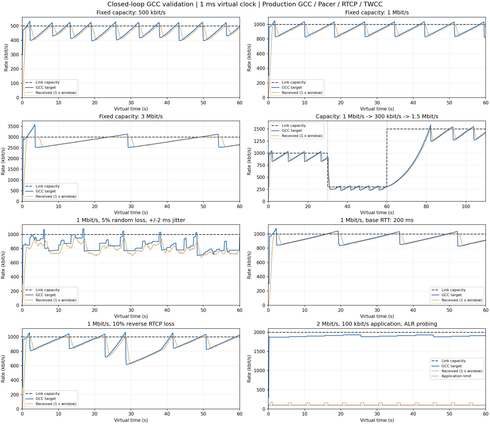

# GCC 码率估计验证

当前工作区的 GCC 在本次 8 组闭环链路仿真中通过容量收敛、带宽下降/恢复、随机丢包、长 RTT、反馈丢失和 ALR 检查。无随机丢包、发送量充足的场景中，各稳态窗口的平均目标为瓶颈容量的 90.34%–93.75%。带宽上升后的恢复比较保守，5% 随机丢包下也有明显降速。本次只增加测试和报告，没有修改算法参数或产品代码。

## 方法

测试入口为 [`gcc_network_simulation_test.cpp`](../tests/webrtc/gcc_network_simulation_test.cpp)。使用生产代码的 `GccTransportController`、`GoogCcNetworkController`、`BitrateProber`、`Pacer`、`RtcpSession` 和 `TransportFeedbackAdapter`，虚拟时间步长 1 ms，共运行 530 秒网络时间。各场景重新创建控制器：起始 300 kbit/s、最低 30 kbit/s、最高 5 Mbit/s，其他算法参数为默认值。

模拟编码端按 30 fps 生成媒体，消费目标码率和 `cwnd_reduce_ratio`。Pacer 调度真实 RTP 明文字节，出队分配 TWCC；探测使用真实媒体和合法 padding，携带探测簇元数据。瓶颈为有序、固定 64 KiB 缓冲区的串行链路：容量变化影响正在服务的包，缓冲区满时尾丢弃，随机丢包发生在串行发送之后。接收侧按到达时间生成真实 RTCP TWCC，经过反向传播后匹配发送历史，反馈再驱动 GCC。容量只用于链路服务和测量，未作为 REMB、容量估计或目标值送入算法。

默认单向传播 25 ms（基础 RTT 50 ms），TWCC 间隔 50 ms，控制 tick 25 ms；反向链路无带宽瓶颈。长 RTT 场景改为单向 100 ms；随机丢包场景另外加入单向 ±2 ms 抖动，可能造成乱序。随机种子固定为 `0x5eed`。RTP 计费包含 TWCC 头和模拟的 16 字节 SRTP tag，SR/RR 也经过网络；加密本身、操作系统 socket 和实际编码器未放入虚拟网络，真实 DTLS/SRTP/ICE/UDP 链路由已有集成测试另行覆盖。

码率单位均为 bit/s（图表显示 kbit/s），容量按正向 UDP 负载总量定义，不计 IP/UDP 头。接收速率为 1 秒滑动窗口内 RTP 字节数，包含探测 padding 与模拟 SRTP tag；它与编码器净 payload 码率不同。稳态值取每段结束前 10 秒的平均，不取最后一个采样点。

## 实测结果

| 场景 | 瓶颈容量 | 平均 GCC 目标 | 平均 RTP 接收速率 | 目标 / 容量 |
|---|---:|---:|---:|---:|
| 固定容量 | 500,000 | 454,216 | 456,101 | 90.84% |
| 固定容量 | 1,000,000 | 935,306 | 939,051 | 93.53% |
| 固定容量 | 3,000,000 | 2,786,591 | 2,808,213 | 92.89% |
| 阶跃 0–30 s | 1,000,000 | 919,113 | 915,851 | 91.91% |
| 阶跃 30–60 s | 300,000 | 274,400 | 274,393 | 91.47% |
| 阶跃 60–110 s | 1,500,000 | 1,406,187 | 1,405,637 | 93.75% |
| 5% 随机丢包、±2 ms 抖动 | 1,000,000 | 777,795 | 737,605 | 77.78% |
| 基础 RTT 200 ms | 1,000,000 | 903,418 | 909,482 | 90.34% |
| 反向 RTCP 丢失 10% | 1,000,000 | 929,916 | 929,010 | 92.99% |
| 应用限制 100 kbit/s，开启周期 ALR 探测 | 2,000,000 | 1,902,175 | 112,090 | 95.11% |

“进入区间”定义为第一次进入容量的 80%–115%，随后连续 3 秒保持在该范围内。按 100 ms 采样计算：

- 固定 500 kbit/s、1 Mbit/s、3 Mbit/s 分别约需 2.7、0.2、3.6 秒。
- 30 秒时，容量由 1 Mbit/s 降至 300 kbit/s，约 0.8 秒进入区间。
- 60 秒时，容量由 300 kbit/s 升至 1.5 Mbit/s，约 18.5 秒进入区间。

这个时间描述首次持续 3 秒达标，AIMD 后续仍有周期性增速、降速和瞬时超调。阶跃降带宽后观测到的最大网络排队约 835 ms，与固定 64 KiB 缓冲区及瞬时过量发送有关；0.8 秒降速不表示队列也已经排空。

5% 随机丢包场景的最终目标约 778 kbit/s，比物理容量低约 22%；它表明当前默认配置在该场景下偏保守。ALR 场景的约 1.90 Mbit/s 表示通过探测保留的可用码率估计，应用仍只提供约 100 kbit/s，接收速率增加部分来自 padding。两者不能用“估计值应等于当前业务吞吐”来判断。



## 自动检查与参考实现

新测试检查稳态目标、实际接收速率、码率上下限，以及探测包、反馈和输入格式。无随机丢包时，平均目标要求在容量的 80%–115%，接收速率要求在 75%–115%；5% 随机丢包时分别采用 60%–115% 和 55%–115% 的安全性/利用率检查。降带宽响应要求小于 5 秒，恢复要求小于 25 秒。ALR 额外检查接收速率仍接近应用发送上限。阈值用于检测明显退化，不把正常的拥塞控制波动当作逐点误差。

同时独立下载并编译 libwebrtc 固定修订版 `602d5fc23caaca7728ad5f3f0e68b92274d1a38a` 的原始 GoogCC 及其估计器，通过原有回放脚本核对：8 组输入、28,800 个发送包的目标、Pacer、窗口和探测输出摘要全部匹配。原版使用与项目一致的经典 ACK 分支；平台日志、环境和实验配置由脚本提供适配。该对照验证移植行为一致性，上述新仿真验证容量变化下的闭环表现。

本次验证还通过了全部 30 项 WebRTC CTest；新增闭环仿真通过 AddressSanitizer、UndefinedBehaviorSanitizer 和 float-cast-overflow 检查，以及 AArch64 `-Wall -Wextra -Wpedantic -Werror` 语法检查。

## 复现

```sh
cmake -S tests/webrtc -B /tmp/uav-gcc-validation-build \
  -DCMAKE_BUILD_TYPE=Debug \
  -DSRTP_ROOT=/path/to/native/libsrtp \
  -DUSRSCTP_ROOT=/path/to/native/usrsctp
cmake --build /tmp/uav-gcc-validation-build --target gcc_network_simulation_test -j2
ctest --test-dir /tmp/uav-gcc-validation-build -R '^gcc_network_simulation$' --output-on-failure

# 从临时目录运行，避免日志写到仓库；CSV 每 100 ms 一行。
(cd /tmp && /tmp/uav-gcc-validation-build/gcc_network_simulation_test /tmp/uav-gcc-traces)
python3 tests/webrtc/plot_gcc_network_simulation.py /tmp/uav-gcc-traces --output /tmp/uav-gcc-validation.png
python3 tests/webrtc/reference/generate_goog_cc_reference.py --directory /tmp/uav-gcc-original
```

绘图需要 matplotlib；正常 C++ 测试不依赖 Python、绘图包或网络。参考源码对照脚本首次运行需要网络及支持 C++20 的编译器，已有下载目录可添加 `--offline`。

这些结果支持“当前实现可以在所测模型中给出可用码率并跟随容量变化”。它们不构成真实无线链路上的全面性能结论；不同排队方式、突发丢包、共享流量及实际编码器反馈延迟仍会改变收敛表现。
