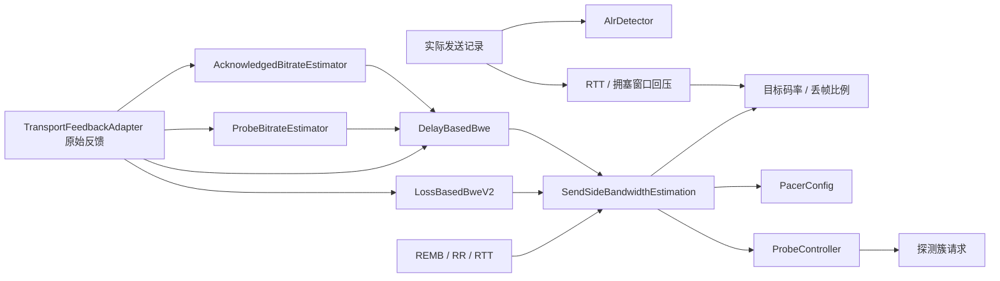

# GoogCcNetworkController

`src/webrtc/congestion_control/goog_cc_network_control.h/.cpp` 实现发送端 GoogCC 总控，参考固定的 libwebrtc 修订版 `602d5fc23caaca7728ad5f3f0e68b92274d1a38a`：

- [GoogCC 总控](https://webrtc.googlesource.com/src/+/602d5fc23caaca7728ad5f3f0e68b92274d1a38a/modules/congestion_controller/goog_cc/goog_cc_network_control.cc)
- [发送端带宽仲裁](https://webrtc.googlesource.com/src/+/602d5fc23caaca7728ad5f3f0e68b92274d1a38a/modules/congestion_controller/goog_cc/send_side_bandwidth_estimation.cc)
- [拥塞窗口回压](https://webrtc.googlesource.com/src/+/602d5fc23caaca7728ad5f3f0e68b92274d1a38a/modules/congestion_controller/goog_cc/congestion_window_pushback_controller.cc)
- [输入输出消息](https://webrtc.googlesource.com/src/+/602d5fc23caaca7728ad5f3f0e68b92274d1a38a/api/transport/network_types.h)

BSD 许可与专利声明保留在 `third_party/webrtc/`。

## 数据流



反馈处理保留原版顺序：更新在途字节和反馈 RTT → ALR 结束通知 → ACK 吞吐 → 探测速率 → 可选网络状态估计 → 探测结果过滤与吞吐保护 → 延迟估计 → 发送端带宽仲裁与丢包模型 → 目标/Pacer/探测输出 → 拥塞窗口更新。丢包模型接收包含丢失包的 `packet_feedbacks`，ACK/探测/延迟检测消费按接收时间排序的已接收记录。

## Transport 自动接入

`DtlsTransport` 通过 `GccTransportController` 管理总控、25 ms 周期定时器、探测执行和 padding。`config.dtls.congestionControl.enabled` 默认开启；内置 SRTP 已 Ready、RTCP 和 Pacer 开启且有协商后的发送媒体时启动。纯 DataChannel 不启动 GCC。PeerConnection 只转交配置、API 和带 generation 的回调。

```cpp
webrtc::PeerConnection::Config config;
config.dtls.enableSrtp = true;
config.dtls.congestionControl.start_bitrate = 600000;
config.dtls.congestionControl.min_bitrate = 30000;
config.dtls.congestionControl.max_bitrate = 3000000;
// config.media 中协商 transport-cc 和 transport-wide-cc RTP 扩展，见 rtcp-feedback.md。
webrtc::PeerConnection::Callbacks callbacks;
callbacks.onTargetTransferRate = [](webrtc::CongestionControlEvent event) {
    // 投递到编码线程：event.rate.target_rate 为 bit/s，整条 BUNDLE 链路共享。
    // 编码端分配到各流，并按需处理 event.rate.cwnd_reduce_ratio。
};
webrtc::PeerConnection peer(io, config, callbacks);
// 正常调用 asyncSendRtp；发送、反馈、调速和探测由 transport 驱动。
webrtc::TargetRateConstraints limits;
limits.min_data_rate = 30000; limits.max_data_rate = 2000000;
peer.setBitrateConstraints(limits);
webrtc::StreamsConfig streams;
streams.requests_alr_probing = true;
streams.max_padding_rate = 100000;
peer.setStreamsConfig(streams);
```

发送链路为 `asyncSendRtp → Pacer → TWCC 分配 → SRTP → adapter.OnSentPacket → GoogCC → UDP Sender`。发送时间在加密后、提交 Sender 前采样；反馈早于异步发送完成也能正确匹配，完成不会重复注册。失败包从 adapter 历史和在途字节移除，下次 tick 校正回压，不虚构发送样本。TWCC 经 SRTCP 认证、解析、同一个 adapter 匹配后，以包含收到和丢失包的原始反馈交给 GCC，用户已有反馈回调继续收到原数据。

GCC 输出立即更新 Pacer 两份预算；码率没有变化时保留已有信用。当前 Pacer 支持 0 或 1 kbit/s–1 Gbit/s，适配层限制 pacing 到此范围，小于 1 kbit/s 的 padding 目标按 0 处理。纯窗口模式将 `congestion_window` 与 adapter 在途字节比较，阻塞 RTP 放行，RTCP/DTLS 仍可发送；默认回压模式由算法生成目标及丢帧比例。

`BitrateProber` 按同一固定修订版的 [原始实现](https://webrtc.googlesource.com/src/+/602d5fc23caaca7728ad5f3f0e68b92274d1a38a/modules/pacing/bitrate_prober.cc) 执行探测簇：达到包大小门限后激活，按簇速率和最小间隔规划 burst，累计字节及 burst 数都满足时完成，迟到超过 10 ms 丢弃当前簇。探测先使用排队媒体，不足时生成合法 RTP padding；探测绕过普通预算等待，但仍扣账、遵守暂停/拥塞窗口、每轮 64 包及 burst 字节上限。簇 ID、最小包数/字节和已发送字节随真实包写入 adapter，TWCC 回来后 ProbeBitrateEstimator 才能得到探测结果。

自动 padding 默认开启，需要先发送一包携带 TWCC 的真实媒体建立头模板。padding 复制该包的 PT、时间戳和全部 RTP 头扩展（包括 MID），使用独立 SSRC 和序号，保留业务 RTP 序号；长度受 MTU、SRTP 上限及 RFC padding 的 255 字节限制。`padding_ssrc=0` 随机选择，显式设置时应保留该 SSRC 给 transport。`generate_padding=false` 禁用自动生成，探测仍可使用真实媒体。非探测 padding 按 `StreamsConfig::max_padding_rate` 补齐总发送速率，默认 0。尚无媒体模板时不会发送 padding。接收回调仍交付完整 RTP，消费媒体时应识别空 payload 的 padding 包；padding 流的缺口不触发 NACK。

无 TWCC 的媒体仍上报实际发送字节，使用 RR、RTT 和 REMB 回退，但不执行无法测量的探测。REMB 的 SSRC 必须匹配本地已发送流；通过 `onRemoteBitrateReport` 可观察。缓存密文重传沿用原 transport sequence，标记接收时间歧义，并将重传字节计入 ALR/分配开销；它没有独立 RTX 发送样本，后续可扩展 RTX。

`setBitrateConstraints` 更新码率范围，`setStreamsConfig` 更新分配、padding、pacing 倍率和 ALR 探测设置，`setNetworkStateEstimate` 转交外部容量上下界。输入事件时间由 transport 采样，控制消息按处理时间排序，adapter 包的原始收发时刻保持不变。目标回调可在 Connected 状态通知附近到达，编码端应同时遵守连接状态和 generation。编码器调速/多流分配仍由回调消费者执行。

GCC 活动时，`setPacingRate(s)` 返回 `operation_not_supported`；手动控制可设置 `config.dtls.congestionControl.enabled=false`。`setPacingPaused` 两种模式均可用；暂停取消当前探测簇，仍保持控制定时器及 RTCP。ICE 暂时 Disconnected 通知总控网络不可用、取消探测并阻塞 RTP，恢复 Connected/Completed 后解除。ICE 换代重建 GCC/探测器并清除统计，旧反馈与旧完成不进入新会话；普通媒体参数重配清空 adapter 历史时也重建估计器。失败和关闭取消 GCC 定时器。`snapshot().dtls->congestionControl` 提供当前目标、pacing、窗口、代次、网络可用状态，以及发送、反馈、tick、探测和 padding 计数；计数表示实际提交 Sender，结合 adapter 的失败计数查看结果。

## 独立调用

所有调用由下层 transport 的同一个 strand/串行上下文驱动。本类不创建线程、定时器或 UDP socket，不拥有 SRTP、DataChannel 或编码器；PeerConnection 不承担拥塞控制。示例中的 `apply` 表示调用方处理输出：

```cpp
using namespace webrtc;
auto now = std::chrono::steady_clock::now();
NetworkControllerConfig cfg;
cfg.constraints.at_time = now;
cfg.constraints.min_data_rate = 30000;
cfg.constraints.starting_rate = 600000;
cfg.constraints.max_data_rate = 3000000;
GoogCcNetworkController controller(cfg);

apply(controller.OnNetworkAvailability({now, true}));
apply(controller.OnProcessInterval({now, {}}));
// 之后每 25 ms 调用一次，可携带当前 Pacer 排队字节数：
apply(controller.OnProcessInterval({later, pacer.snapshot(later).queuedBytes}));

// adapter.ProcessSentPacket() 返回的发送记录，每次实际发送只上报一次：
apply(controller.OnSentPacket(sent_record));
// adapter.ProcessRtcp()/ProcessTransportFeedback() 产生的完整原始反馈：
apply(controller.OnTransportPacketsFeedback(feedback));
```

`apply(update)` 应处理以下字段：

| 字段 | 调用方操作 |
|---|---|
| `target_rate` | 更新编码/分配码率；使用 `cwnd_reduce_ratio` 实现编码端丢帧策略 |
| `pacer_config` | 取 `data_rate()` / `pad_rate()` 调用 `Pacer::setRates()` |
| `probe_cluster_configs` | 交给探测执行器产生并调度实际探测包，将簇元数据带入发送记录 |
| `congestion_window` | 启用纯窗口模式时限制在途数据；启用回压时窗口由内部回压器消费 |

每个返回值的 optional 仅表示本次是否有更新。REMB、RR 和 RTT 事件通常返回空更新，后续反馈或周期 tick 发布目标。`GetNetworkState()` 可获取当前快照；与原版相同，它暴露回压后的目标，且不额外计算 `cwnd_reduce_ratio`。默认丢帧模式的实时 `target_rate` 事件则携带回压前码率和丢帧比例。

独立使用 `GoogCcNetworkController` 时，调用方处理全部输出；使用 `DtlsTransport` / `PeerConnection` 时，上述自动接入已处理传输、Pacer 与探测输出，应用消费目标码率回调。

## 默认行为和类型

- 配置/输出码率单位为 bit/s，大小单位为 byte，时间使用 `steady_clock::time_point` 和 `microseconds`。构造必须提供正的 `starting_rate`。配置码率支持 0–1 Gbit/s，实际下限至少 5 kbit/s，与项目 ALR/字节预算范围一致；原版发送端仲裁的默认上限也是 1 Gbit/s。
- `GoogCcConfig` 使用显式字段替代 field trials；可配置已有 ACK、ALR、Delay、Loss、Probe 组件，支持独占可选 `NetworkStateEstimator`、`NetworkStatePredictor`。ACK 采用本项目已有的经典 `AcknowledgedBitrateEstimator`，对应原版关闭 robust throughput 的分支。
- 默认开启 LossBasedBweV2。它就绪前保留原版 RR 回退：累计至少 20 包生成 Q8 丢包比例；低丢包按最近一秒最小码率增长 8% 加 1 kbit/s；高丢包按原版 RTT/300 ms 限频降速。REMB 默认只限制对外目标，保留内部估计以便上限解除后恢复。
- 默认开启 3 秒 RTT 回退，按发送时刻和最后传播 RTT 更新时间修正，超过门限后每秒乘 0.8，最低 5 kbit/s。无发送时不因定时器流逝持续增大 RTT。
- 首次收到非空 TWCC 前，默认 pacing 倍率为 `2.5f`，之后为 `1.1f`；显式 `StreamsConfig::pacing_factor` 覆盖默认值。内部保留 float 常量的提升精度。`PacerConfig` 默认 40 ms 窗口，零窗口表示按 1 秒存储速率；`码率 × 时间` 按最近字节取整，反算速率截断，输出可能与未量化速率略有差异。
- Pacer 输出基于回压前码率；若最终 pacing 速率超过当前 `Pacer` 支持的 1 Gbit/s，调用方应限制配置上限/倍数，并检查 `setRates()` 返回值。
- 默认拥塞窗口使用最近 32 次反馈的最大 RTT 中的最小值，加 350 ms 排队裕量；窗口按目标速率计算并与上次窗口取均值，至少 3000 byte。默认回压开启且为丢帧模式，回压最低目标 30 kbit/s；可关闭回压只输出窗口，也可完全关闭窗口机制。填充比大于 1.5 乘 0.9、大于 1 乘 0.95、低于 0.1 恢复 1，其余乘 1.05，最高 1。
- `OnStreamsConfig` 保留原版逐字段更新语义；`enable_repeated_initial_probing` 在初始配置生效，后续消息不切换此字段。
- `OnNetworkRouteChange` 重建 ACK、探测估计和延迟检测，执行带宽仲裁/探测策略的路由重置。保留原版未清除的 ALR、反馈 RTT 窗口、已有拥塞窗口、网络估计等状态；`restart_bwe` 与该修订版一样不影响此处理。
- 本地控制事件时间必须非负且按时间顺序提交。发送记录必须有时间，反馈必须有完整发送历史，接收时刻属于重建的远端时钟域，可晚于本地反馈时刻。`NetworkStateEstimate::update_time` 是估计计算时间，可早于交付；相同时间戳的更新和原版一样只更新缓存，不重新通知探测控制器。
- 为适配项目现有严格时间校验，延迟的首次 tick 将初始约束的应用时间对齐当前事件；首次 tick 前显式提交的新约束或路由不会被旧初始约束覆盖，初始 stream 设置仍在首次 tick 应用。这些是本地生命周期修正，不属于原版的数值公式。
- `NetworkRouteChange::generation` 可绑定新 ICE/adapter 代次，随后旧代次反馈直接忽略；未指定时在首次有效反馈绑定。路由变化时调用方也应重置 adapter，防止旧发送历史进入新路径。

日志使用项目现有 log 库，前缀 `[WebRTC][GoogCC]`、`[WebRTC][SendSideBwe]`、`[WebRTC][CwndPushback]`，高频 DEBUG/TRACE 在格式化前检查级别。

传输接入使用 `[WebRTC][GCC Transport]` 和 `[WebRTC][BitrateProber]`，分别记录启动及探测簇排队、完成、迟到丢弃。

## 验证

闭环容量收敛、带宽阶跃、随机丢包、长 RTT 和 ALR 的实测数据、曲线及复现方法见 [GCC 码率估计验证](gcc-bitrate-validation.md)。

```sh
cmake -S tests/webrtc -B /tmp/uav-goog-cc-build -DCMAKE_BUILD_TYPE=Debug
cmake --build /tmp/uav-goog-cc-build --target goog_cc_network_control_test -j2
ctest --test-dir /tmp/uav-goog-cc-build -R '^goog_cc_network_control$' --output-on-failure
python3 tests/webrtc/reference/generate_goog_cc_reference.py --directory /tmp/uav-goog-cc-original
```

原版对照独立编译固定修订版的 GoogCC、发送端仲裁、回压、ACK、ALR、Probe、Delay、AIMD、LossBasedBweV2 及原始整数单位，使用相同输入回放。仅替换平台日志、环境时钟和实验配置接口，并明确选择经典 ACK 分支。脚本需要网络和 C++20（原版 `std::span`），正常产品/CTest 仍为 C++17 且不访问网络。已有同修订版下载目录可用 `--offline` 重放。

8 组回放共 28800 个发送包，将每次目标/Pacer/窗口/探测输出的字段纳入固定摘要验证；比例字段量化到 1e-9，码率、字节、时间等整数字段直接比较摘要。场景包括延迟增长/恢复、丢包、ALR、REMB、流分配、路由和安全重置、网络上界、RR 回退，以及关闭窗口、改变回压方式、把 Pacer 队列纳入回压、零 pacing 窗口等配置。独立集成用例还覆盖真实 RTCP TWCC 编解码 → adapter → GoogCC → Pacer 参数应用、外部估计器/预测器和输入校验。

`gcc_transport_controller_test` 覆盖探测激活、簇间调度、迟到、队列边界、窗口门控、探测计费、RR 乱序和 REMB 编解码。`dtls_transport_test` 覆盖真实 DTLS/SRTP/SRTCP 的探测 padding、头扩展/序号、TWCC 元数据回传、REMB/运行时上限/Pacer 调速、持续 padding、暂停、关闭、代次、非 TWCC 回退、早反馈和失败释放拥塞窗口；`peerconnection_test` 验证真实 ICE/UDP 上的自动 GCC、编码端回调、动态接口和重启转交。
