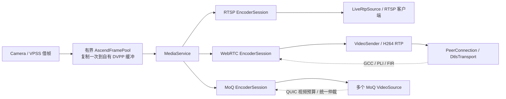

# 多视频源编码与媒体订阅

同一个视频源创建三个独立编码实例，复用 `VideoEncoder` / `VencEncoder` 实现，由 `MediaService` 持有。WebRTC 默认允许一个视频订阅；RTSP 与 MoQ 不设置业务层订阅人数上限，多订阅者共享对应协议的一路编码。人数增长只增加有界订阅队列和网络会话，不创建新的硬件编码器。

板端同时发布三个独立视频源：`rgb.main` 2566×1520、`rgb.sub` 1920×1080、`thermal.main` 640×512。每源各有 RTSP/WebRTC/MoQ 编码，总计九个 VENC 通道；每源默认一个 WebRTC 订阅，三源可同时观看。`AscendMediaDevice` 统一管理三源生命周期和同一端口的 RTSP 注册，源级码率预算互相独立。

| 输出 | 编码与订阅策略 | 默认配置 |
|---|---|---|
| RTSP | 一路稳定码率，所有客户端共享；RR 不改变编码目标 | H264，2 Mbit/s |
| WebRTC | 一路自适应编码，默认一个视频订阅，GCC/PLI/FIR 转交编码控制 | H264，初始 300 kbit/s，30 kbit/s–5 Mbit/s |
| MoQ | 一路自适应编码，多订阅者共享并统一仲裁视频预算 | 初始 300 kbit/s，30 kbit/s–5 Mbit/s |

“一路 WebRTC”按一个 `MediaService` 所管理的视频源计数。DataChannel、PeerConnection 对象和信令连接本身不计入视频订阅名额；媒体发送器通过 `service.subscribe(Output::WebRtc)` 取得名额。超过默认上限抛出 `resource_unavailable_try_again`，订阅关闭或析构立即释放名额。`maxWebRtcSubscribers` 可配置，0 表示取消上限并共享同一编码实例。

当前 `src/moq/video_source.*` 实现媒体入口、稳定对象标识和码率控制接口，**尚未实现 MoQ/QUIC 网络协议栈**。板端已将 WebRTC 媒体发送器、PeerConnection 和 Gateway 信令接入，详见 [WebRTC 实时视频](webrtc-live.md)。`--encode` 启动 RGB 编码及 RTSP；同时配置 Gateway 时可通过 `/webrtc` 播放。

## 对象与数据流



- `media/video_frame.*`：协议中立的原始帧、完整 Annex-B 编码访问单元及参数集；共享不可变输出字节。
- `encode/video_encoder.h`：编码后端接口。`EncoderSession` 串行执行启动、码率更新、IDR 请求、编码及停止，每实例一个 worker，最多保留两张最新待编码原始帧。
- `encode/venc_encoder.*`：CANN MPI VENC 后端，默认 CBR / NORMAL_P，不产生 B 帧；编码控制使用 bit/s，SDK 边界转换为 kbit/s。合并后的码率请求在 worker 上通过通道属性 API 生效。
- `media/media_service.*`：创建固定三路编码、并发订阅准入、码率仲裁、编码帧分发。没有订阅者的输出不接收原始帧。
- `webrtc/video_sender.*`：一帧一帧发送，RTP 完成后继续下一片；网络失败后清除剩余分片并等待新 IDR。GCC、关键帧及连接状态回调与应用已有回调串接。
- `rtsp/live_source.*`：共享访问单元接到原有 `RtpSource`；每个 IDR 前附带参数集，新客户端触发合并后的 IDR 请求。
- `moq/video_source.*`：每个直连订阅者一个接口，或每条设备到 relay 的发布链路一个接口。所有订阅者消费同一编码实例的共享帧。
- `media/ascend_media_pipeline.*`：板端装配，管理三路编码、按尺寸区分的输入池、可选 RTSP 服务和其独立 I/O 线程；相机、ACL 运行环境由应用持有。`webrtc/video_service.*` 在独立 I/O 线程管理信令协商、视频订阅与 PeerConnection，Gateway 管理 HTTP 和播放授权。

公共帧头不引用 CANN 类型；平台适配器用 `AscendFrameBuffer` 持有帧描述和缓冲所有权。编码结果含源帧标识、PTS/DTS、源代次、码流代次、参数集版本、关键帧和 GOP 标识。当前无 B 帧配置下，DTS 与 PTS 相同。各网络发送器分别维护自己的 RTP 序号、SSRC 或协议打包状态。

## 码率控制

`MediaSubscription::updateBudget(NetworkBudget)` 接受连接分配给视频的预算：

```cpp
media::NetworkBudget budget;
budget.generation = connectionGeneration;
budget.bitrateBps = targetVideoBitrateBps;
budget.overheadBps = reservedOverheadBps;
budget.reduceRatio = congestionWindowReduction;
subscription->updateBudget(budget);
```

视频目标取 `bitrateBps * (1 - reduceRatio)`，扣除 `overheadBps`，再按配置上限约束。预算为 0 或低于编码最低码率时暂停送入编码器；恢复时请求 IDR。采集及另外两路编码继续工作。同一订阅上较旧 generation 的反馈被拒绝，新的连接使用新的订阅对象。

WebRTC 适配器消费 `onTargetTransferRate` 的 `target_rate` 和 `cwnd_reduce_ratio`；额外封装/重传预留由 `VideoSender::Config::overheadReserveBps` 指定。`target_rate` 是 transport 总预算时，应用还需先为音频等其他业务分配额度。编码预算与 pacing 速率分别处理，padding/probe 仍由 transport 执行。

MoQ 直连多个客户端时，默认取活跃订阅视频预算的最小值，符合“一路编码供所有订阅者解码”的约束。尚未收到预算的订阅使用该路初始码率；断开时须 `close()` 或销毁对应 `VideoSource`，预算随即移除。该策略会让弱网 MoQ 订阅者影响其他 MoQ 观看者的共同画质，但不会影响 RTSP/WebRTC。若以后需要不同观看者获得不同画质，可增加有限的共享编码档位。

通过 relay 发布时，为设备到 relay 的上行建立一个 `VideoSource` 并反馈上行视频预算；relay 下游观看人数不直接增加设备编码实例或订阅。QUIC 拥塞控制和媒体码率分配分别接入，媒体层不会额外安装第二套 QUIC 拥塞算法。

## 队列、恢复及生命周期

每个订阅默认最多 16 个访问单元、8 MiB、500 ms。溢出或超时会清除依赖链，等待带完整参数集的随机访问帧；只对该订阅丢帧。关键帧请求默认按 300 ms 合并，源换代及首次编码可立即请求。MoQ 发布取消或发送失败后调用 `VideoSource::resync()`，WebRTC 分片失败自动执行相同恢复。各协议还应保持自己的有界发送队列。

MoQ 的 `{epoch, groupId, objectId}` 来自编码流代次、GOP 序号和 GOP 内帧序号。身份由编码端生成，同一个 AU 在多个订阅中标识一致，丢帧不重编号。进程内重建编码会话不会重复使用 epoch；进程重启须建立新的 track 身份。编码重启后应用须将新 epoch 映射到新的 track 身份或相应重新发布流程。`VideoObject` 是媒体交接结构，QUIC 封装及 MoQ wire 格式由发布器处理。

公共订阅与控制接口可并发调用；订阅者在自己的 executor 上 `tryPop()`，编码 worker 不执行用户网络回调。`EncoderSession` 输出回调只做服务内部快速入队；生命周期操作在应用控制线程执行。`LiveRtpSource::pump()` 保持一个生产者，或使用 `AscendMediaPipeline` 的独立 RTSP I/O 线程。

`MediaService::start()` 等待三路硬件准备完毕，任一路失败就停止已启动的编码器。退出时先停止采集投递，再关闭网络及订阅、停止编码并等待缓冲归还，最后销毁 VPSS/ACL context。SDK 输入在 `get_stream` 得到结果前不能释放，输出复制到独立内存后才 `release_stream`；参见 [CANN 输入寿命约束](https://www.hiascend.com/doc_center/source/zh/canncommercial/70RC1/inferapplicationdev/aclcppdevg/aclcppdevg_03_1049.html)。

## 板端入口

```sh
cmake --preset ascend-aarch64
cmake --build --preset ascend-aarch64 -j2

# 板卡运行，同时发布三个源，编码目标最高 30 fps。
./build/ascend-aarch64/bin/uav_detection --encode --duration 30
# RTSP：rtsp://设备地址:8554/live/rgb
# RTSP：rtsp://设备地址:8554/live/rgb/sub
# RTSP：rtsp://设备地址:8554/live/thermal
# 改端口：--rtsp-port 9554（同时启用编码）
```

不传 `--encode` / `--rtsp-port` 时保留双相机诊断采集。编码开启后三个 VPSS 输出分别供各自的 RTSP/WebRTC/MoQ 编码器。默认 VENC 起始通道为 0/3/6，各组使用 `firstChannel + 0/1/2`；任一组启动失败就回滚整个媒体装配，避免通道和帧池遗留。

每种尺寸的输入池默认最多 8 个缓冲，按需分配，同尺寸输出共享同一张自有 DVPP 输入帧。`submitBorrowed()` 在相机回调内复制再返回 VPSS；池满时丢弃该输入。编码会话按尺寸接收匹配帧并降帧率。不同尺寸由现有 VPSS 主/子通道提供，不新增 VPSS 硬件绑定。

## WebRTC 接入示例

在启动 `io_context` 工作线程之前完成装配。`peerConfig` 须配置匹配硬件 profile/level 的 H264、`packetization-mode=1`、transport-cc 和 RTP 扩展；PT 对应协商结果。`maxPayloadBytes` 为 MID、TWCC、SRTP 及路径 MTU 留出空间。

```cpp
auto subscription = pipeline.service().subscribe(media::Output::WebRtc);
auto peerSlot = std::make_shared<std::weak_ptr<webrtc::PeerConnection>>();
webrtc::VideoSender::Config videoConfig;
videoConfig.rtp.payloadType = 96;
videoConfig.rtp.maxPayloadBytes = 1000;
auto video = std::make_shared<webrtc::VideoSender>(io, subscription,
    [peerSlot](auto packet, auto done) {
        if (auto peer = peerSlot->lock()) peer->asyncSendRtp(std::move(packet), std::move(done));
        else done(boost::asio::error::operation_aborted, 0);
    }, videoConfig);
webrtc::PeerConnection::Callbacks callbacks;
// 先设置应用回调，再串接编码反馈，原回调会保留。
video->bindCallbacks(callbacks);
auto peer = std::make_shared<webrtc::PeerConnection>(io, peerConfig, callbacks);
*peerSlot = peer;
// 应用进行 SDP/ICE 信令；Connected 后自动取帧发送。
// 同时持有 video/peer；关闭 peer 或 video 即释放视频名额。
```

PeerConnection 不持有编码器。不同 H264 PT、codec 或 MID 的重协商需要应用更新/重建媒体适配器；当前适配器处理连接断开/恢复、ICE 换代预算及关键帧恢复，不自动实现跨 codec 切换。

## 验证

```sh
cmake -S tests/media -B /tmp/uav-media-tests -DCMAKE_BUILD_TYPE=Debug
cmake --build /tmp/uav-media-tests -j2
ctest --test-dir /tmp/uav-media-tests --output-on-failure
```

`media_service_test` 使用真实编排/队列/协议适配器与可控编码后端，覆盖 128 个 RTSP 及 128 个 MoQ 订阅共享三实例、并发 WebRTC 单名额、预算和代次隔离、暂停/恢复、输入租约、过载/超时/IDR 恢复，以及 32 个 RTSP 传输和 WebRTC H264 分片/发送失败。

安装 CANN 头文件时还构建 `venc_encoder_test`，对真实 SDK 类型编译平台后端，以主机替身验证三通道、bit/s→kbit/s、帧池复用、HOST/DEVICE 复制路径、取流偏移、输出复制、超时输入持有、启动回滚，以及真实本地 RTSP socket 的管线启动/停止/重启。主机测试不代表板端吞吐已验证；三路并发的画幅、帧率、码率范围及资源占用仍须实机确认。
