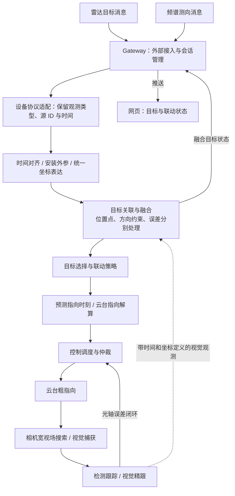

# 雷达、频谱与光电设备联动

状态：架构补充，尚未实施。已知输入字段包含距离、方位、俯仰和测向角；雷达、频谱设备与当前云台可能异地安装。每类设备实际提供哪些字段、字段的坐标基准和测向对象，仍需以设备协议和安装记录确定。

**联动条件**

异地安装时，必须同时处理位置差异和朝向差异。雷达的距离、方位、俯仰可构成三维目标位置；将其变换到共同空间，再从云台的位置计算目标视线，最后通过云台机械标定得到可执行指向。只复制雷达的方位/俯仰，或只加一个固定角度偏差，不能普遍补偿异地安装造成的视差。

| 某设备实际输出 | 可以得到的空间约束 | 联动方式 |
| --- | --- | --- |
| 距离、方位、俯仰 | 该传感器坐标系中的三维点 | 转到公共坐标系，再计算云台指向 |
| 三维坐标 | 点，但坐标系需明确 | 变换原点、轴向和时间后使用 |
| 经纬度、高程 | 地理位置，高程基准需明确 | 统一地理基准，转 ECEF / 本地 ENU，再计算指向 |
| 方位与俯仰，没有距离 | 从测向站出发的一条射线 | 结合雷达航迹或多站观测约束距离；异地云台不能据此唯一确定指向 |
| 只有水平测向角 | 方位平面或带误差的方位扇区 | 关联雷达航迹，或扫描搜索；不能当作完整三维点 |
| 只有频率、带宽、信号强度 | 信号观测，缺少唯一空间方向 | 用于告警、分类或关联，不能单独生成精确空间指向 |

频谱测向应保留为方向观测，不能人为填一个固定距离后冒充目标位置。还需确认测向发射源与要跟踪的空中目标是否对应。AOA 测向与多接收站 TDOA 定位是不同观测方式，参见 [Rohde & Schwarz 的 AOA/TDOA 说明](https://www.rohde-schwarz.com/us/solutions/critical-infrastructure/spectrum-monitoring/tdoa-and-aoa-hybrid-geolocation-systems_232792.html)。

**坐标系与标定**

建议定义以下坐标关系：

```text
site：站点统一空间，本地 ENU
  ├─ radar_frame：雷达观测原点及轴向
  ├─ df_frame：频谱测向参考点及轴向
  └─ ptz_base：云台基座及机械零位
       └─ pan / tilt：随当前轴角变化的坐标关系
            └─ camera_optical：相机光心与光轴
```

采用米、秒、弧度作为内部单位。site 可约定 x 向东、y 向北、z 向上；设备本体框架可约定 x 向前、y 向左、z 向上；相机光学框架可约定 x 向右、y 向下、z 向前。厂商协议的北向/零位、顺逆时针和角度单位在适配层转换。这些可参考 [REP-103 坐标与单位约定](https://github.com/openrobotics/reps/blob/main/_posts/rep-0103.md)，采用这些约定不要求项目引入 ROS。

每台设备需要记录：

- 安装位置：经纬度、高程或现场测量的共同空间坐标；高程采用一致基准。
- 安装姿态：航向、俯仰、横滚，以及轴序和旋转方向。
- 观测原点：雷达测量参考点、测向参考点、云台旋转中心和相机光心的相对位置。
- 云台标定：零位、角度正方向、机械范围、实际角度反馈，以及轴系/光轴偏差。
- 相机标定：内参、畸变及随变焦变化的参数，用于目标投影和视觉精跟。
- 时间与误差：观测时间、时钟映射、延迟、测角/测距误差和标定版本。

固定安装的外参可作为配置保存；移动平台需要按观测时刻获取站位和姿态。安装外参有误时，坐标变换公式正确也会产生系统指向偏差。

**位置变换与指向解算**

令雷达坐标系 R 已归一化为 x 前、y 左、z 上，方位 alpha 从 x 向 y 为正，俯仰 beta 向上为正。距离 r、方位和俯仰得到：

```text
p_R = [r*cos(beta)*cos(alpha),
       r*cos(beta)*sin(alpha),
       r*sin(beta)]
```

令 S 为公共站点坐标系，B 为云台固定基座坐标系；R_SR 表示从雷达轴向到 S 的旋转，t_SR 表示雷达原点在 S 中的位置，R_SB 和 t_SB 表示云台基座的对应安装关系：

```text
p_S = R_SR * p_R + t_SR
p_B = transpose(R_SB) * (p_S - t_SB)
```

这两步包含朝向与异地位置的补偿。三维点在云台基座中得到后，理想正交轴、指向原点与旋转中心近似重合时，可先求几何指向：

```text
yaw   = atan2(y_B, x_B)
pitch = atan2(z_B, sqrt(x_B*x_B + y_B*y_B))
```

再根据机械零位、正方向和光轴标定转换为云台命令。存在明显相机偏置、非理想轴系或近距离目标时，通过完整的云台运动学/光轴模型解算，不能把上述理想公式直接当作所有设备的机械命令。

一个位置差异的例子：在同一 ENU 空间中，雷达位于 (0, 0, 0)，云台位于 (1000, 0, 0)，目标位于 (1000, 1000, 100)，单位均为米。按“正北为 0°，向东顺时针增加”的地理方位定义，雷达观测约为方位 45°、俯仰 4.04°；云台应指向方位 0°、俯仰 5.71°。两站都校准到同一北向后，仍有明显的指向差异。

对具备方位和俯仰的纯测向数据，只有单位方向 d_D：

```text
p_S(lambda) = t_SD + lambda * R_SD * d_D, lambda > 0
```

lambda 未知时，目标可能位于射线上不同距离。从异地云台看这些候选点，指向通常不同。因此，需要关联雷达位置、多站交会或其他距离约束；只有水平测向角时，约束还要更弱。数据不足时，应明确输出搜索区域与不确定性，而不是输出伪精确位置。

**接入当前架构**



建议增加明确的多传感器联动责任边界，可逐步形成 radar、spectrum 适配器，以及 fusion 中的空间标定、坐标转换、目标关联与融合状态。Gateway 负责接入、鉴权和路由；几何、融合和指向解算在板端服务执行，网页展示状态并发出目标选择等任务命令。

输入契约应区分 PositionObservation、BearingObservation 与 SignalObservation，至少带 source_id、source_track_id、观测时间、frame_id、有效字段、误差和标定版本。统一坐标系不等于目标已经关联：不同设备的目标 ID 不共享含义，仍需结合位置/方位、时间、速度及观测类型判断是否同一目标。

时间流程是：按观测时刻的设备姿态转换数据，再把目标状态预测到预计指向时刻。频谱方向约束、雷达位置和视觉结果都保留新鲜度及误差；过期或冲突的观测不能直接覆盖当前目标。为提高视觉捕获成功率，先以较宽视场覆盖指向误差，再在捕获后收窄视场。

对只有方位约束的频谱数据，不能直接执行高置信三维点指向；它可以帮助筛选雷达航迹或触发方位区域搜索。完整闭环的完成条件是：有足够空间约束、安装标定和时间基准，粗指向能把目标带入可搜索视场，视觉捕获后可持续精跟。
